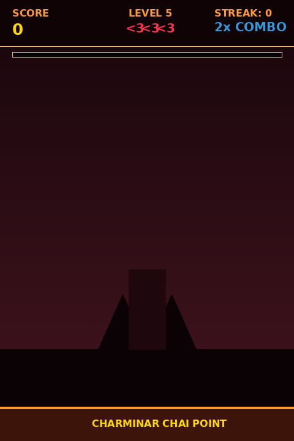

# ☕ Hyderabad Rush! 🍪

> A premium, fast-paced Candy Crush-level browser clicker game inspired by the rich street food culture of Old City Hyderabad.

[](https://madhu-sunkari2.github.io/hyderabad-rush/)
[](https://hyderabad-rush-796910223127.us-central1.run.app)
[-orange?style=for-the-badge)](index.html)

🎮 **Permanent Play Link (GitHub Pages)**: [https://madhu-sunkari2.github.io/hyderabad-rush/](https://madhu-sunkari2.github.io/hyderabad-rush/)  
🔗 **Cloud Run Workshop Mirror**: [https://hyderabad-rush-796910223127.us-central1.run.app](https://hyderabad-rush-796910223127.us-central1.run.app) *(Active during workshop)*

<p align="center">
  
</p>

---

## 🌟 Overview

**Hyderabad Rush** is an arcade-style, mobile-responsive clicker game set against the iconic silhouette of the Charminar. Players catch famous Hyderabadi delicacies raining from the sky before they hit the ground, building high combos, triggering fever frenzies, battling slow-falling Shahi Biryani bosses, and collecting power-ups — all backed by rich visual juice and real-time synthesized audio.

---

## 🎯 Gameplay Mechanics & Capabilities

Every mechanic is implemented natively with zero external runtime dependencies:

| Feature / Layer | Implementation | What It Does |
|---|---|---|
| 🍪 **Delicacies & Scoring** | 5 Hyderabadi Specialties | • **Osmania Biscuit**: `+10 pts`<br>• **Irani Chai**: `+15 pts`<br>• **Mirchi Bajji**: `+20 pts`<br>• **Haleem Bowl**: `+25 pts`<br>• **Double ka Meetha**: `+30 pts` |
| 🛺 **Matching Combo Multiplier** | Same-Item Catch Detector | Catching **3 identical delicacies in a row** triggers a **2x multiplier** and an authentic Hyderabadi Auto-Rickshaw horn honk sound |
| 🔥 **Chain Reaction FEVER MODE** | Rapid Burst Detector | Catching 5 delicacies within 2.5 seconds unlocks **FEVER MODE** (screen glows hot pink, speed ramps up, and all catches earn **3x points** for 5 seconds) |
| ❤️ **Lives & Miss System** | 3 Hearts System | Missing 3 delicacies costs 1 heart. Game over triggers when all 3 lives are lost |
| 🥘 **Boss Encounters** | Levels 5 & 10 Boss Waves | Giant **Shahi Biryani Handi** falls slowly from the sky, rewarding **100 bonus points** upon capture |
| 🎁 **Power-Up System** | Falling Dynamic Orbs | • 🧲 **Magnet**: Attracts falling snacks toward the center<br>• ⏳ **Slow Motion**: Halves gravity speed for 5s<br>• ✨ **Double Points**: 2x score multiplier (stacks with Fever!) |
| 🎵 **Zero-Asset Audio Engine** | Native **Web Audio API** | Real-time oscillator synthesizers produce the festive Nawabi background melody, pitch-shifting catch chimes, and rickshaw horn effects without downloading audio files |
| ✨ **Visual Polish & FX** | HTML5 Canvas + CSS | Multi-particle crumb bursts, glowing motion trails, screen shakes, screen flashes, Candy Crush-style animated callouts (`NICE!`, `GREAT!`, `LEGENDARY!`), and confetti celebrations |
| 💾 **Persistence & Modes** | LocalStorage + Daily Seed | Top-5 local leaderboard, player name personalization, pause menu, and a deterministic **Daily Challenge Mode** based on calendar date |

---

## 🏆 Progression & Level Curve

The game features 10 escalating difficulty tiers:

```
[Level 1] Osmania Biscuits + Irani Chai
    ⬇
[Level 2] Unlocks Mirchi Bajji (Speed +12%)
    ⬇
[Level 3] Unlocks Haleem Bowl (Speed +24%)
    ⬇
[Level 4] Unlocks Double ka Meetha (Speed +36%)
    ⬇
[Level 5] 🥘 SHAHI BIRYANI BOSS BATTLE (+100 pts)
    ⬇
[Levels 6-9] High-velocity storm + dense powerup spawns
    ⬇
[Level 10] 👑 ULTIMATE NAWABI BOSS BATTLE
```

---

## 🛠️ Architecture & Tech Stack

- **Pure Single-File Design**: Fully bundled into [`index.html`](index.html) with semantic HTML5, responsive CSS3, and modern vanilla JavaScript.
- **60 FPS Performance**: Physics, trails, particle explosions, and hit-detection loop managed through `requestAnimationFrame`.
- **Zero Dependencies**: No libraries, no frameworks, no CDN dependencies, no external audio/image assets needed.
- **Deployment Ready**: Includes a production `Dockerfile` with custom `nginx.conf` listening on Cloud Run's native `8080` port.

---

## 🚀 Running Locally

Clone the repository and open `index.html` in any modern web browser:

```bash
git clone https://github.com/madhu-sunkari2/hyderabad-rush.git
cd hyderabad-rush

# Run local static server (optional)
python3 -m http.server 8080
```

Visit `http://localhost:8080` in your browser.
